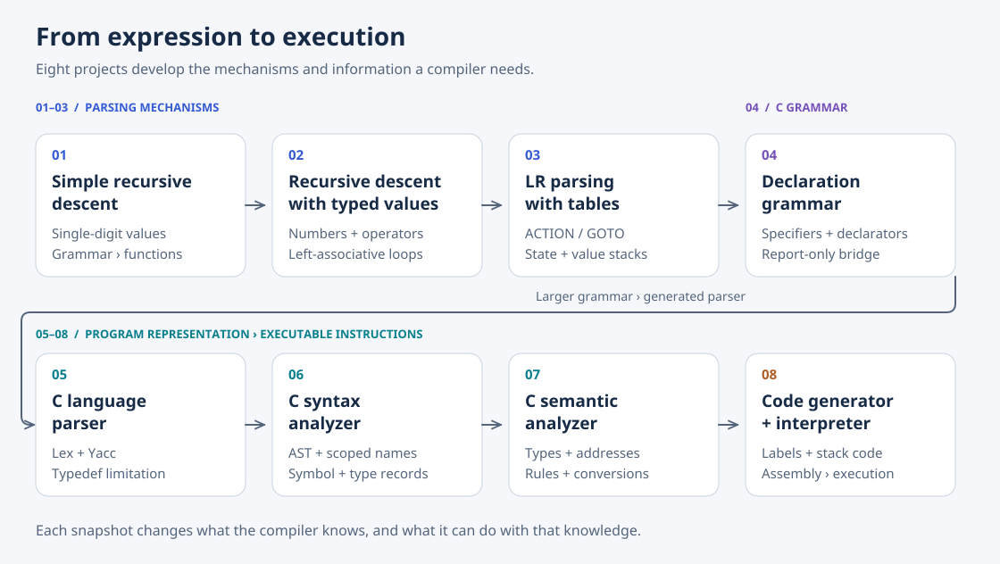
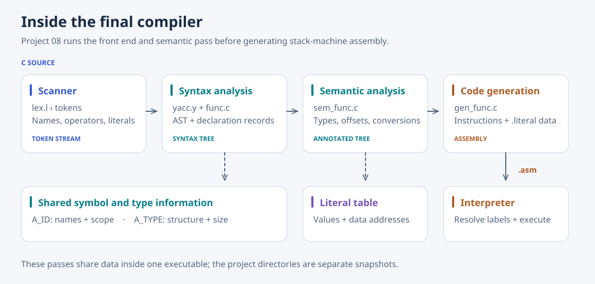

# Compiler

**How does an expression calculator become a compiler?** Eight projects from the Compiler course at Soongsil University (Fall 2025) follow that question from recursive descent and LR parsing to a C subset compiler that emits assembly for a stack machine.

The early projects compute values while parsing. The later projects preserve a program as a tree, resolve its names and types, and turn that information into instructions. Each step exposes a problem the next step can address: recognizing a declaration is insufficient to remember a type name; building a tree is insufficient to validate an operation; validating an operation is insufficient to execute it.



## The path from 01 to 08

| Project | What changes | Source | Short write-up |
| --- | --- | --- | --- |
| 01 · Simple recursive descent | Map grammar rules directly to functions; evaluate single-digit expressions. | [01-simple-rd-parser](01-simple-rd-parser/) | Covered below |
| 02 · Recursive descent | Add typed numbers, more operators, and left associativity. | [02-rd-parser](02-rd-parser/) | [02-rd-parser](docs/02-rd-parser.md) |
| 03 · LR parsing | Replace recursive control with ACTION/GOTO tables and parallel stacks. | [03-LR-parser](03-LR-parser/) | [03-LR-parser](docs/03-LR-parser.md) |
| 04 · Declarations | Study how specifiers and recursive declarators describe C objects and functions. | Report-only study | [04-declaration](docs/04-declaration.md) |
| 05 · C language parser | Express a C subset in Lex and Yacc; recognize complete translation units. | [05-c-language-parser](05-c-language-parser/) | [05-c-language-parser](docs/05-c-language-parser.md) |
| 06 · C syntax analyzer | Build an AST with symbol and type information, including scoped type names. | [06-c-syntax-analyzer](06-c-syntax-analyzer/) | [06-c-syntax-analyzer](docs/06-c-syntax-analyzer.md) |
| 07 · C semantic analyzer | Check meaning and annotate types, storage addresses, and conversions. | [07-c-semantic-analyzer](07-c-semantic-analyzer/) | [07-c-semantic-analyzer](docs/07-c-semantic-analyzer.md) |
| 08 · Code generator | Traverse the annotated tree and emit stack-machine assembly. | [08-code-generator](08-code-generator/) | [08-code-generator](docs/08-code-generator.md) |

### 01–03: understand the parser before generating one

Project 01 starts with four grammar rules:

```text
E → T + E | T
T → F * T | F
F → D | ( E )
D → 0 | 1 | … | 9
```

`expression()`, `term()`, `factor()`, and `digit()` mirror those rules. A character at a time supplies the lookahead token, multiplication binds more tightly than addition, and nested parentheses recurse into `expression()`. Parsing and evaluation happen together: `2+3*4` produces `14`.

Project 02 makes the calculator more useful: multi-digit integers and decimal numbers, `+ - * / %`, spaces, and mixed numeric operations. Iteration at the expression and term levels makes subtraction and division left associative. The report also identifies the missing unary signs and proposes extending `factor()` to handle them; that proposal is a limitation of this snapshot, not an implemented feature.

Project 03 changes the parsing method. A 12-state LR parser selects shift, reduce, accept, or error through an ACTION table; reductions use a GOTO table and a parallel value stack to evaluate productions. Its implemented language returns to integers, `+`, `*`, and parentheses so the focus stays on the mechanism. The report explores subtraction and division, then identifies the need for token-to-column mapping and stack bounds checks. The move to a larger C grammar makes generated parsing tables practical in Project 05.

### 04–06: move from expressions to a program representation

Project 04 is the conceptual bridge. Declaration specifiers describe storage, qualifiers, and base types; declarators add names, pointers, arrays, and function parameters. There is no standalone 04 source directory: its report explains the grammar that the next parser implements.

Project 05 combines a Lex scanner with a Yacc grammar for declarations, functions, expressions, and statements. It recognizes syntax and reports the line and nearby token on errors, but does not construct the explicit AST used in later stages. Two findings guide the next step:

- A hard-coded list recognizes only `int`, `float`, `char`, and `void`. A newly declared `typedef` name is forgotten, so a later declaration using it fails. The report calls for a symbol table and persistent type information.
- Nested `if` statements produce a dangling-`else` shift/reduce conflict. Yacc's default shift attaches `else` to the nearest unmatched `if`; the report proposes making the choice explicit.

Project 06 adds `A_NODE`, `A_ID`, and `A_TYPE` records. Grammar actions construct a tree and connect identifiers to types; the scanner consults scoped identifiers to recognize typedef names. Basic declaration checks now catch undefined names, redeclarations, and conflicting declarations. Distinct `if` and `if/else` nodes represent the chosen parse, although the grammar still reports the conflict.

The report deliberately leaves deeper checks for the semantic analyzer: a call returning `void` can still appear in an assignment, and a nonexistent struct field is not rejected here. It also records the declarations-before-statements block grammar, motivating a future mixed block-item rule.

### 07–08: give the tree meaning, then give it instructions

Project 07 walks the syntax tree to validate expressions, lvalues, calls and returns, aggregate types, array bounds in declarations, and the context of control statements. Valid programs acquire types, object sizes, frame offsets, and literal addresses; numeric conversions can appear as cast nodes. The report explicitly connects these annotations to the information needed for code generation.

Project 08 consumes that representation. Expressions emit loads and arithmetic in evaluation order; statements emit labels and jumps; calls reserve stack space and transfer control to functions. Array and pointer operations use element sizes from semantic analysis. Float and string literals are emitted separately as `.literal` data. The included interpreter assembles labels and runs the resulting instructions.



The final compiler reuses the front end from 06 and the semantic pass from 07 inside Project 08. These directories are successive snapshots; they are not separate executables piped together.

## Try it

Use Linux or WSL with a C compiler, Make, and Lex/Yacc-compatible tools. On Debian or Ubuntu:

```bash
sudo apt-get install build-essential flex bison
```

From the repository root, start with the calculator:

```bash
gcc 01-simple-rd-parser/rd-parser.c -o /tmp/simple-rd-parser
printf '2+3*4\n' | /tmp/simple-rd-parser
# 14
```

Then generate and interpret assembly:

```bash
cd 08-code-generator
make
./code_generator -o /tmp/compiler-test02.asm test-src/test02.c
./interp /tmp/compiler-test02.asm
```

`test02.c` assigns `10 + 20 * 3`. In the assembly, `MULI` precedes `ADDI`, demonstrating how tree structure determines evaluation order. The interpreter prints a symbol table, resolved instructions, and execution markers; this example does not print the assigned value. Its legacy `void main` also means its process exit status is not a dependable success signal.

The per-project write-ups contain the remaining build commands and explain their inputs and outputs. Generated scanner/parser C files are checked in; the Makefiles for 06–08 regenerate them.

## Examples and implementation limits

Project 06 includes valid programs and declaration-error examples. Project 07 has four valid fixtures, 33 error fixtures, and four warning fixtures. Project 08 pairs 13 source examples with saved assembly and interpreter transcripts, covering arithmetic, control flow, calls, arrays and pointers, short-circuit evaluation, recursion, conversions, and strings.

These are course examples for a C subset. The current back end leaves declaration-initializer emission empty and reports unimplemented code generation for struct member access and `switch`/`case`/`default`. Recognition or semantic validation of a construct therefore does not imply executable support. The standalone 07 tree printer also crashes on some float-literal fixtures; its write-up distinguishes report results from the current snapshot.

## Documentation

The short write-ups preserve the reports' findings and their connections to later projects, with links to the corresponding source. SVG figures redraw selected tree outputs and explain the parser and compiler mechanisms. They use Noto Sans with outlined labels so the typography stays consistent without installed fonts; the font license is included under [docs/assets](docs/assets/NotoSans-OFL.txt).

Original Word reports and extracted screenshots remain outside the repository.
