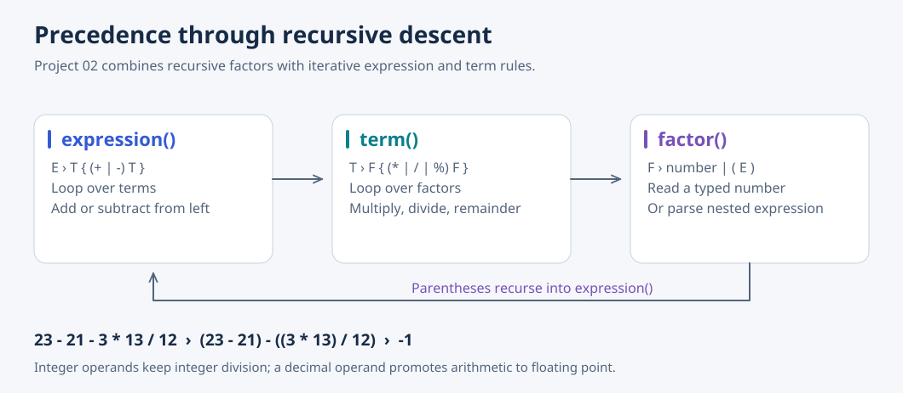

# 02 · Recursive-Descent Parser

[Overview](../README.md) · [Source](../02-rd-parser/) · [Next: LR parsing](03-LR-parser.md)

Project 01 evaluated single-digit expressions with addition and multiplication. This project introduces a token carrying either an integer or a floating-point value, and expands the grammar to multi-digit numbers, decimals, subtraction, division, and remainder.



## What it does

`expression()` repeatedly combines terms with `+` or `-`; `term()` repeatedly combines factors with `*`, `/`, or `%`. These loops preserve left associativity while keeping multiplication, division, and remainder above addition and subtraction. `factor()` handles numbers and parentheses. The scanner ignores spaces, and a newline ends the expression.

Mixed arithmetic promotes integers to floating point. The implementation includes conversion warnings, division-by-zero checks, and rejection of noninteger remainder operands. Warning emission is asymmetric because it compares token types after promoting the result; it does not reliably warn for every mixed operation.

## Findings and the next step

The report identifies unsupported unary `+` and `-` and proposes checking for a sign at the start of `factor()`. That extension is not present in the source. Project 03 instead changes the parsing strategy to LR tables, allowing the same grammar-to-evaluation relationship to be studied from the bottom up.

## Run

From the repository root:

```bash
gcc 02-rd-parser/rd-parser.c -o /tmp/rd-parser
printf '23 - 21 - 3 * 13 / 12\n' | /tmp/rd-parser
# -1
```

This report example combines space handling, integer division, precedence, and left associativity.
