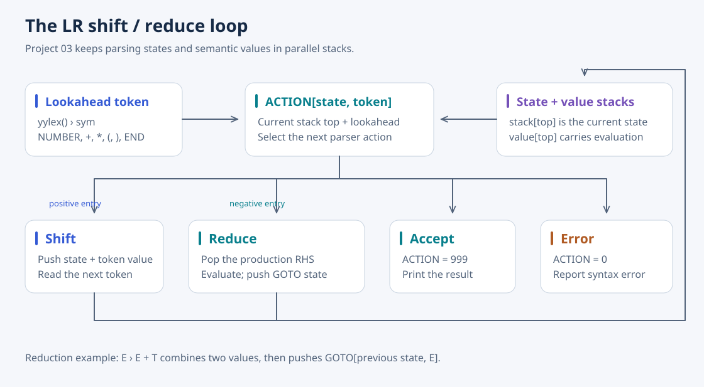

# 03 · LR Parser

[Overview](../README.md) · [Source](../03-LR-parser/) · [Next: declarations](04-declaration.md)

This project replaces recursive calls with a table-driven shift/reduce parser. Its smaller expression language supports multi-digit integers, `+`, `*`, and parentheses; floating-point arithmetic and the additional operators from Project 02 are not carried into this implementation.



## What it does

The ACTION table has 12 states and six terminal columns. Positive entries shift, negative entries select a production to reduce, `999` accepts, and zero reports a syntax error. GOTO selects the new state after a reduction. Parallel state and value arrays let `reduce()` evaluate addition, multiplication, and parenthesized expressions as productions are recognized.

## Findings and the next step

The report tests an experimental replacement of `+` with `-` and `*` with `/`, then considers supporting all four. Equal precedence alone does not make the existing table a complete implementation: token classification, productions, table entries, and reduction semantics must agree. Grouping operators would also require preserving the actual operator for evaluation.

The report proposes an explicit token-to-column mapping instead of `sym - 256`, and bounds checks for the fixed-size stacks. Neither improvement is implemented here. Project 04 studies C declarations before Project 05 moves the larger grammar to Lex/Yacc-generated machinery.

## Run

From the repository root:

```bash
gcc 03-LR-parser/LR-parser.c -o /tmp/LR-parser
printf '3+2*3+2*(1+2)\n' | /tmp/LR-parser
# Success!
# Result: 15
```
