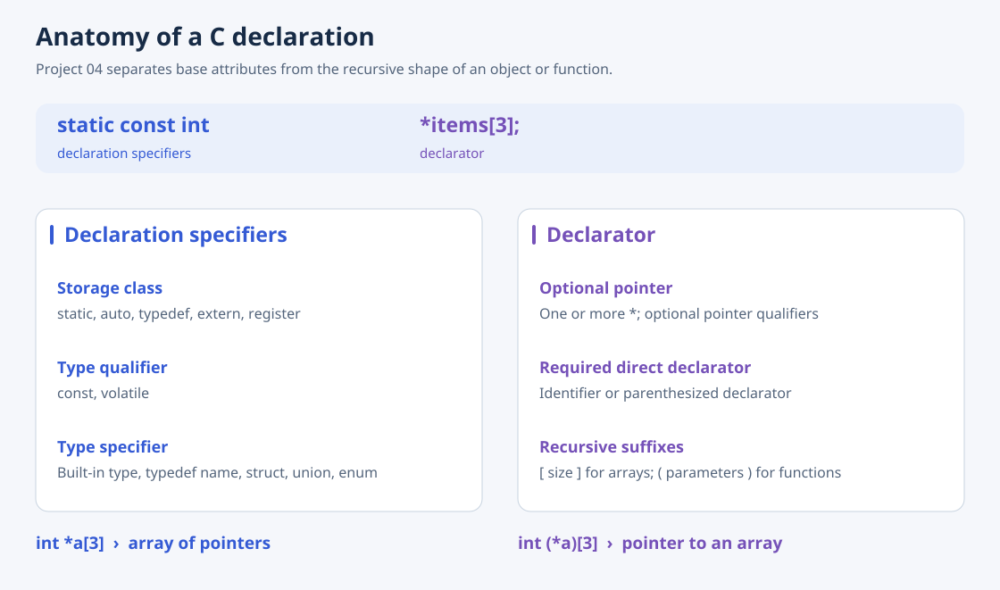

# 04 · Declaration Specifiers and Declarators

[Overview](../README.md) · [Previous: LR parsing](03-LR-parser.md) · [Next: C language parser](05-c-language-parser.md)

This report-only project explains the C declaration grammar that bridges expression parsing and a complete translation unit. There is no standalone 04 source directory or executable.

## What a declaration describes

Declaration specifiers precede the declarator and combine three categories:

| Category | Report examples | Purpose |
| --- | --- | --- |
| Storage class | `auto`, `static`, `typedef`, `register`, `extern` | Storage duration, linkage, or creation of a type alias, depending on context |
| Type qualifier | `const`, `volatile` | Restrictions on modification or access semantics |
| Type specifier | Built-in types, typedef names, `struct`, `union`, `enum` | The base type of the declaration |

A declarator combines an optional pointer with a required direct declarator. A direct declarator starts with an identifier or a parenthesized declarator, then recursively adds array brackets or function parameter lists. Parentheses distinguish forms such as `int *a[3]` (array of pointers) and `int (*a)[3]` (pointer to an array).

The report also describes struct/union members, bit-field widths, and enum constants with optional explicit values.

## Connection to Project 05

Project 05 turns these grammar forms into Yacc productions. The report's description is broader than the implemented subset: for example, 05 recognizes only `auto`, `static`, and `typedef` as storage-class keywords, and `const` as a qualifier. Recognizing the shape of a declaration still leaves the next problem open: remembering what a declared type name means when it appears again.
