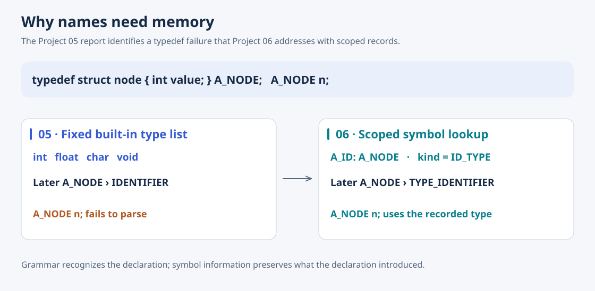

# 05 · C Language Parser

[Overview](../README.md) · [Source](../05-c-language-parser/) · [Previous: declarations](04-declaration.md) · [Next: syntax analyzer](06-c-syntax-analyzer.md)

Lex token patterns and Yacc productions turn the declaration study into a parser for a C subset. The start symbol accepts a translation unit containing declarations and function definitions; the grammar also covers expressions, blocks, conditionals, loops, and jump statements.



## Findings that lead to Project 06

The report highlights two problems. First, `checkIdentifier()` recognizes type names through a fixed table containing `int`, `float`, `char`, and `void`. A declaration such as `typedef struct node { int value; } A_NODE;` parses, but `A_NODE n;` fails because the scanner still returns `IDENTIFIER` for `A_NODE`. The report calls for a table that records typedef names and informs subsequent token classification.

Second, dangling `else` produces a shift/reduce conflict. Yacc chooses shift, binding `else` to the nearest unmatched `if`. Explicit precedence is proposed as a way to document the choice and suppress the warning.

The report concludes that symbol/type records and an explicit syntax tree are needed. This implementation recognizes syntax without constructing that persistent AST. It can accept semantically invalid constructs such as `break` outside a loop; later passes must check their meaning.

## Run

From the repository root:

```bash
cd 05-c-language-parser
cc main.c lex.yy.c y.tab.c -o a.out
printf 'int main() { return 0; }\n' | ./a.out
./a.out < test.c
```

Valid input produces no success message. The checked-in `test.c` exercises the typedef limitation and reports a syntax error. To regenerate the scanner and parser, run `yacc -d c-grammar.y` and `lex c-lex.l` before compiling.
