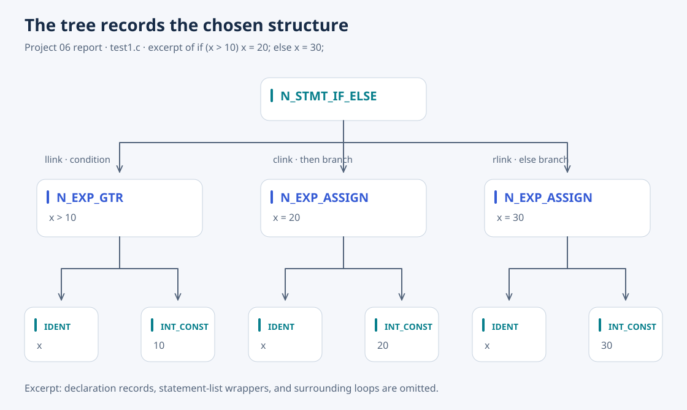

# 06 · C Syntax Analyzer

[Overview](../README.md) · [Source](../06-c-syntax-analyzer/) · [Previous: C parser](05-c-language-parser.md) · [Next: semantic analyzer](07-c-semantic-analyzer.md)

This stage constructs an AST while maintaining scoped identifiers and their types. `A_NODE` represents syntax, `A_ID` records names and declaration attributes, and `A_TYPE` connects pointers, arrays, functions, and aggregates to their component types. The scanner uses these records to classify typedef names, addressing Project 05's fixed-table limitation.



*Redrawn from the report's `test1.c` tree output. Declaration records and surrounding statement-list nodes are omitted to focus on the conditional.*

## What it checks

Grammar actions build nodes and perform basic declaration checks, including undefined identifiers, redeclarations, and conflicting function declarations. The report records fixes to grammar names, node constructors, and a reversed argument order in `setDeclaratorListSpecifier()` that caused a segmentation fault.

## Findings that lead to Project 07

The report shows assignments involving `void` calls and references to nonexistent struct fields that this stage does not reject. Those checks require expression types and aggregate-member validation, which belong to semantic analysis.

Two grammar limitations remain: dangling `else` still produces a conflict, and a block requires all declarations before all statements. The report proposes a mixed block-item rule for the latter; it is not implemented in this snapshot. AST nodes make the selected `if`/`if-else` structure explicit without removing the grammar conflict.

## Run

From the repository root:

```bash
cd 06-c-syntax-analyzer
make
./a.out < test1.c
./a.out < err4.c
```

The first input prints a syntax tree; the second demonstrates undefined-identifier diagnostics. `test1.c`–`test4.c` and `err2.c`–`err7.c` preserve the report's examples.
