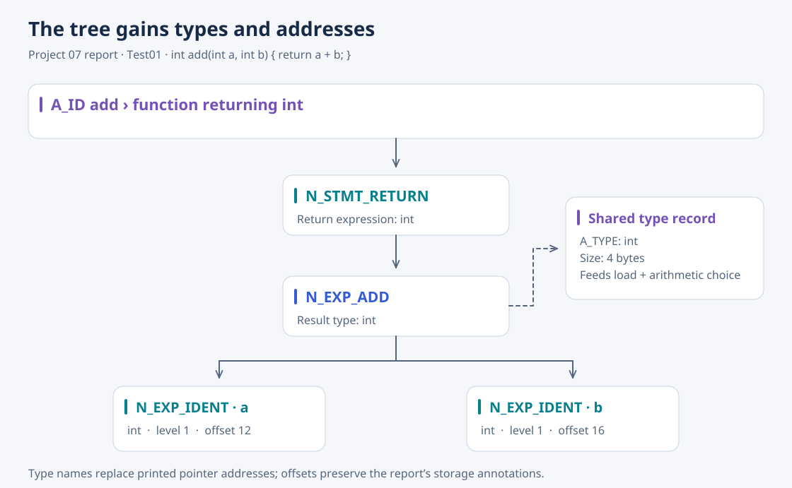

# 07 · C Semantic Analyzer

[Overview](../README.md) · [Source](../07-c-semantic-analyzer/) · [Previous: syntax analyzer](06-c-syntax-analyzer.md) · [Next: code generator](08-code-generator.md)

The semantic pass consumes Project 06's syntax tree and checks whether declarations and expressions obey the language's meaning rules. Valid nodes acquire type information, lvalue status, object sizes, storage offsets, and literal references.



*Redrawn from the report's `Test01` semantic-tree output, focusing on `add(a, b)`. Nondeterministic pointer addresses are replaced by type names.*

## What it checks

The fixtures cover arithmetic and scalar requirements, assignable lvalues, calls and argument counts, return conversions, struct members, array and pointer operations, constant expressions, and the placement of `case`, `default`, `break`, and `continue`. Invalid programs report semantic errors; permitted numeric conversions can produce warnings and inserted cast nodes.

## Information passed to Project 08

The report explicitly identifies type and address annotations as input to code generation. A variable's level and offset determine its load/store address; element size determines pointer arithmetic; conversions select instructions such as `CVTF` and `CVTI`. Literal-table addresses and function-frame sizes provide the remaining storage information.

The report also records float-literal printing crashes. In the current snapshot, `test/warn14.c` still crashes in the standalone analyzer on the tested Linux environment, so the report's warning examples should not be read as a guarantee that every fixture runs successfully.

## Run

From the repository root:

```bash
cd 07-c-semantic-analyzer
make
./a.out < test/test01.c
./a.out < test/err37.c
```

The first prints an annotated tree; the second rejects an unknown struct field. The fixture set contains four valid cases, 33 error cases, and four warning cases.
