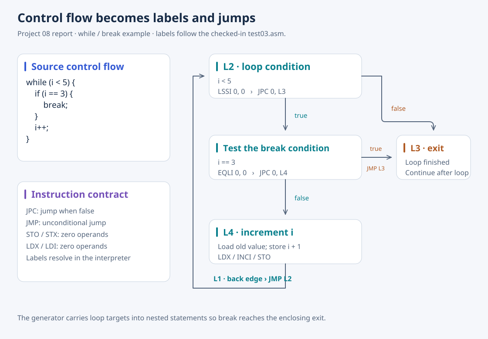

# 08 · Code Generator

[Overview](../README.md) · [Source](../08-code-generator/) · [Previous: semantic analyzer](07-c-semantic-analyzer.md)

The final project incorporates syntax and semantic analysis, then traverses the annotated tree to emit assembly for the included stack-machine interpreter. It completes the path from reading expressions to generating instructions from a program representation.



*Redrawn from the report's while/break explanation and `test03.c`. Labels use the checked-in assembly's names; the report uses different numbering for the same roles.*

## What the report demonstrates

Expressions emit stack loads and typed arithmetic; statements create labels and jumps. The 13 examples cover memory layout, precedence, conditionals and loops, calls and returns, arrays and pointers, array parameters, short-circuit evaluation, recursion, prefix/postfix increments, conversions, and string literals. Global accesses use level 0 and function-local accesses use level 1. Array indexing scales an index by element size before applying `OFFSET`.

The debugging narrative links generated code to the interpreter's instruction contract: `STO`, `STX`, `LDX`, and `LDI` require zero operands. It also records fixes to pointer-type inspection, an `if` child link, and a scalar-type condition inherited from semantic analysis.

## Current boundaries

`gen_initializer_global()` and `gen_initializer_local()` are empty, so declaration initializers do not emit initialization instructions. Struct member access and `switch`/`case`/`default` generation report “not implemented.” The examples demonstrate emitted instruction patterns; saved execution transcripts alone do not verify final values. The interpreter's legacy `void main` can return a nonzero process status after printing `end execution`.

## Run

From the repository root:

```bash
cd 08-code-generator
make
./code_generator -o /tmp/compiler-test02.asm test-src/test02.c
./interp /tmp/compiler-test02.asm
```

Without `-o`, the generator writes `a.asm`. Sources, saved assembly, and execution transcripts are paired under `test-src/`, `test-asm/`, and `test-interp/`. The interpreter source is under `interpreter/`; to rebuild it, run `yacc -d interp.y`, `lex interp.l`, and `gcc -w y.tab.c lex.yy.c interp.c lib.c -o ../interp` there.
